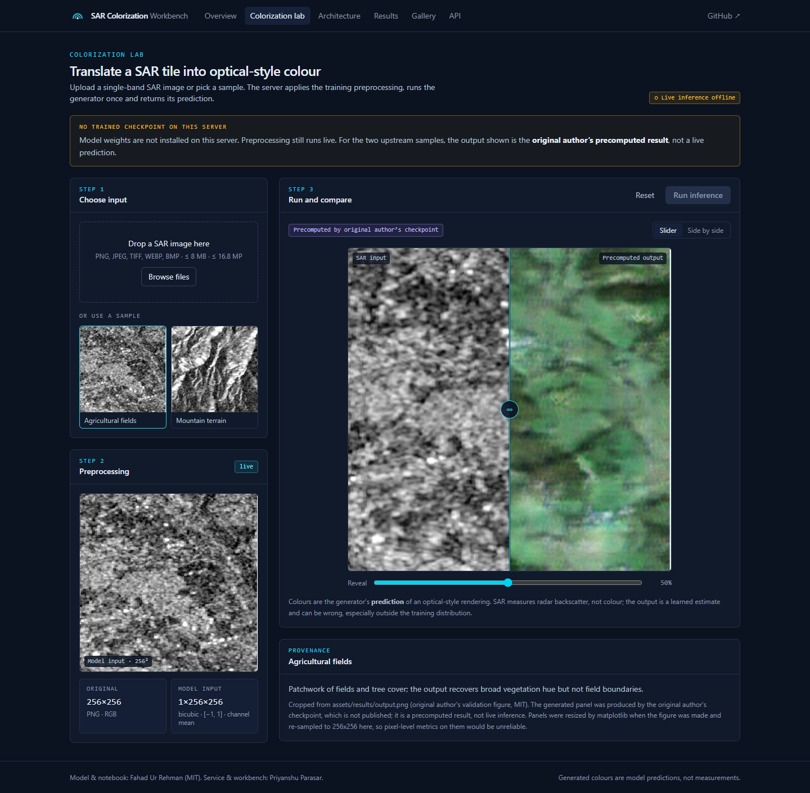
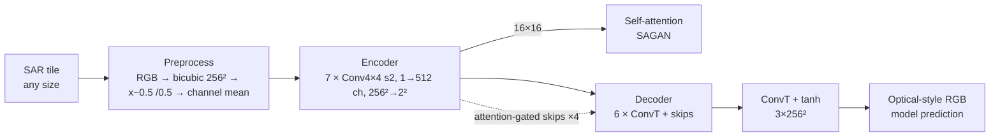
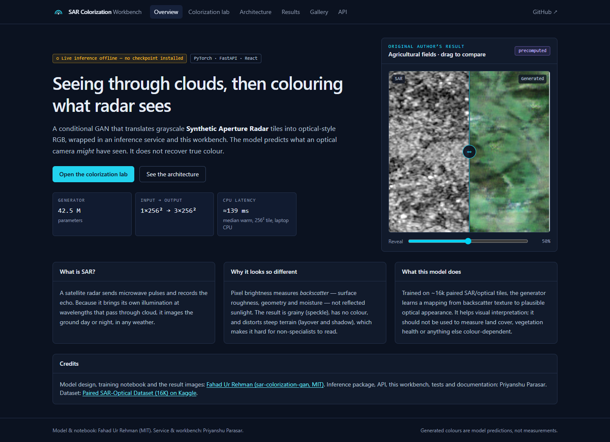
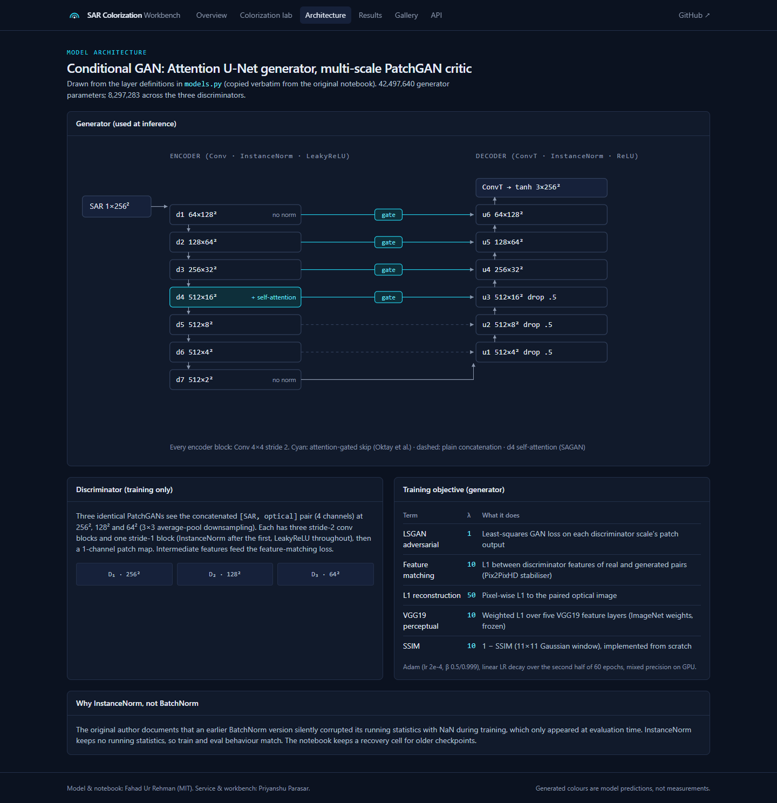
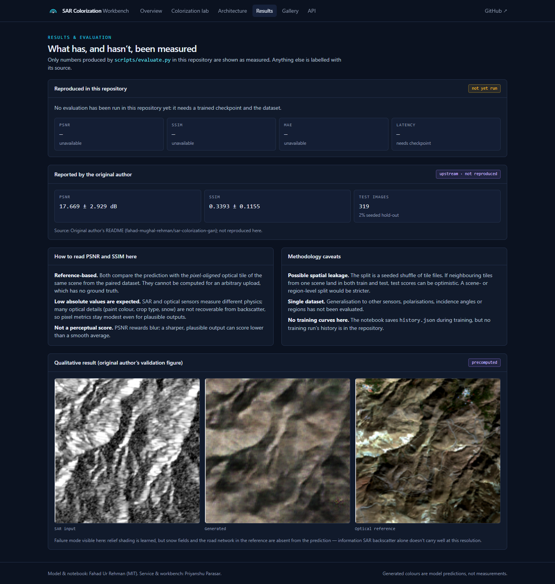

# SAR Imagery Colorization — Attention GAN inference workbench

Translate grayscale **Synthetic Aperture Radar (SAR)** tiles into **optical-style RGB** with a conditional GAN, served through a FastAPI inference service and an interactive web workbench.

> **Attribution.** The model, its training notebook and the result images are the work of **Fahad Ur Rehman** —
> [fahad-mughal-rehman/sar-colorization-gan](https://github.com/fahad-mughal-rehman/sar-colorization-gan) (MIT), imported here with its full commit history.
> This repository adds the inference package, API, web application, tests and documentation (Priyanshu Parasar). See [ATTRIBUTION.md](ATTRIBUTION.md).



| | |
|---|---|
| **Status** | Inference stack complete and tested. **No trained checkpoint is published yet** — live colorization is disabled until one is installed (see [Model weights](#model-weights)). |
| **Live demo** | Not deployed yet. |
| **Stack** | Python 3.12 · PyTorch · FastAPI · React 19 + TypeScript + Tailwind · Docker |

## What the model does — and doesn’t

SAR satellites measure microwave **backscatter**. They see through cloud and work at night, but the images are grainy, colourless and hard to read. This model learns, from ~16k paired SAR/optical tiles, to predict what an optical camera *might* have seen.

The output is a **learned estimate, not measured colour**. It is useful for visual interpretation, and unsuitable for anything colour-dependent: land-cover classification, vegetation indices, change detection or damage assessment.

## Architecture

From [`src/sar_colorization/models.py`](src/sar_colorization/models.py), copied verbatim from the original notebook, so checkpoints trained there load directly.



| Part | Detail |
|---|---|
| Generator | Attention U-Net: self-attention at the 16×16 bottleneck, attention gates (Oktay et al.) on the four highest-resolution skips, InstanceNorm, dropout 0.5 in the first three up-blocks. **42,497,640 parameters.** |
| Discriminator (training only) | Three PatchGANs at 256², 128², 64² (Pix2PixHD style); 8,297,283 parameters. |
| Objective | LSGAN (λ 1) + feature matching (10) + L1 (50) + VGG19 perceptual (10) + SSIM (10). Adam 2e-4, 60 epochs, LR decay over the second half, AMP. |

## The workbench

| Overview | Architecture | Results |
|---|---|---|
|  |  |  |

- **Colorization lab**: drag-and-drop or sample input. Live preprocessing preview of the exact 1×256×256 tensor the model sees, inference, a before/after slider (keyboard-accessible), a side-by-side view, fullscreen zoom and PNG download.
- **Architecture**: diagram generated from the real layer definitions.
- **Results**: shows only metrics measured in this repository; upstream numbers are labelled as upstream.
- **Gallery**: the original author’s validation samples, labelled *precomputed*.
- **API**: endpoints, limits read from the running server, error codes.

Precomputed results are always badged as precomputed and are never presented as live inference.

## Results

| Source | PSNR | SSIM | Test images |
|---|---|---|---|
| **Original author’s README** (not reproduced here) | 17.669 ± 2.929 dB | 0.3393 ± 0.1155 | 319 (2% seeded hold-out) |
| **This repository** | not yet measured | not yet measured | needs a checkpoint and the dataset |

Run [`scripts/evaluate.py`](scripts/evaluate.py) with a checkpoint to produce `evaluation/evaluation.json`. The web app then shows those numbers as measured.

**Methodology caveats** (details in [docs/MODEL_CARD.md](docs/MODEL_CARD.md)):
- the split is a seeded shuffle of *tiles*, not scenes, so neighbouring tiles from one scene may appear in both train and test;
- PSNR/SSIM require a pixel-aligned optical reference and are meaningless for arbitrary uploads.

### Measured inference cost (this repository)
Generator forward pass, one 256×256 tile, CPU only, on a 12-thread Intel laptop (PyTorch 2.15 CPU):
- **≈139 ms** median warm (≈194 ms on the first call), with about **550 MB** resident memory;
- **329 ms** server-side through the API, about 0.9 s round trip in the browser.

Measured with untrained weights; latency does not depend on the weight values.

## Model weights

No checkpoint is committed or published yet: the original author did not release one, and this machine has no GPU to train one.

To produce one:

```bash
# Kaggle GPU notebook (P100/T4), dataset attached; resumes automatically across sessions
python scripts/train.py --data-dir /kaggle/input/<dataset>/Paired_SAR_Optical_images --out /kaggle/working --epochs 60
python scripts/export_generator.py /kaggle/working/checkpoints/last.pt weights/generator.pt --fp16   # ≈85 MB
python scripts/evaluate.py --data-dir <same> --weights weights/generator.pt --out evaluation
```

Checkpoints are loaded with `torch.load(weights_only=True)`, so a malicious pickle cannot execute code. In Docker, set `SAR_WEIGHTS_URL` and `SAR_WEIGHTS_SHA256` and the weights are downloaded and checksum-verified at start.

## Run locally

```bash
python -m venv .venv && . .venv/Scripts/activate      # macOS/Linux: source .venv/bin/activate
pip install torch torchvision --index-url https://download.pytorch.org/whl/cpu
pip install -r requirements-serve.txt pytest httpx ruff
(cd frontend && npm ci && npm run build)
uvicorn api.main:app --port 8000        # http://localhost:8000 — API docs at /api/docs
```

Or with Docker: `docker build -t sar-colorization . && docker run -p 7860:7860 -v $PWD/weights:/app/weights sar-colorization`.

## API

| Method | Path | Purpose |
|---|---|---|
| GET | `/api/health` | Liveness + `model_ready` |
| GET | `/api/model` | Architecture, I/O contract, checkpoint metadata, limits |
| POST | `/api/colorize` | multipart `file` → base64 PNG prediction, preprocessed input, latency |
| POST | `/api/preprocess` | multipart `file` → the exact model input (works without weights) |
| GET | `/api/samples`, `/api/samples/{id}/{sar\|generated\|reference}` | Bundled samples with provenance |
| GET | `/api/evaluation` | Measured metrics, or an explicit “not run” |

Errors use one shape, `{"error": {"code", "message"}}`: 400 invalid image, 413 too large, 415 unsupported format, 429 rate limited, 503 model unavailable, 504 timeout.

**Safety limits** (environment-configurable):
- 8 MB uploads, 16.7 MP maximum, PNG/JPEG/TIFF/WEBP/BMP only;
- the header is checked before full decode (decompression-bomb guard);
- 20 requests per minute per client, one inference at a time, 30 s timeout;
- in-memory processing with no temp files, no server paths in responses, and security headers on every response.

## Tests

```bash
pytest -q        # 44 tests
```

| Suite | What it proves |
|---|---|
| `test_preprocessing.py` | Inference preprocessing equals the notebook’s torchvision transforms (≤ 1e-6); decoding limits and error cases |
| `test_model.py` | Shapes, tanh range, verbatim parameter count, both checkpoint formats, fp16 export, **refusal of pickled code** |
| `test_api.py` | Every endpoint and error code, rate limiting, spoofed `X-Forwarded-For` ignored, sample path-traversal blocked |

Model tests use **random weights**: they verify structure and plumbing, **not output quality**. There is no real-checkpoint test until a checkpoint exists. CI (GitHub Actions) runs lint, tests and the frontend build on CPU only.

## Repository layout

```
notebooks/            original training + evaluation notebook (upstream)
scripts/              train.py, evaluate.py, export_generator.py, fetch_weights.py, crop_results.py (upstream)
src/sar_colorization/ models / losses / data (verbatim from notebook), preprocessing, inference, metrics
api/                  FastAPI service
frontend/             React + TypeScript workbench
assets/               upstream result figure; demo samples cropped from it
tests/                pytest suite
docs/                 model card, dataset notes, deployment, screenshots
```

## Limitations

- No published checkpoint, so no live colorization yet and no metrics reproduced here.
- Fixed 256×256 input. Larger images are downsampled, losing detail; tiling is future work.
- Trained and reported on one dataset. Generalisation to other sensors, polarisations or regions is untested.
- The sample gallery has only two scenes, the upstream author’s; they were resized by matplotlib, so they are unsuitable for pixel metrics.

## Licence

MIT — see [LICENSE](LICENSE). The dataset is not redistributed and remains under its own terms ([docs/DATASET.md](docs/DATASET.md)).
